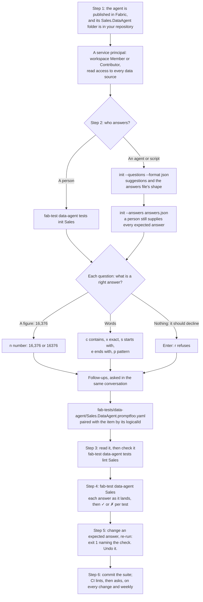

# Walkthrough: regression-testing a Fabric Data Agent

This walks you from a published Fabric Data Agent with no checks to a pipeline that fails when the agent gives a wrong figure, forgets a conversation, or answers a question it should decline. It takes about 20 minutes, most of it waiting for the agent. fab-test asks the deployed agent real questions through [promptfoo](https://www.promptfoo.dev/) and reports through the same envelope, exit codes and HTML report as every other analyzer.

You will:

1. Get the agent's definition into your repository, and give fab-test a service principal that can ask it questions.
2. Run `fab-test data-agent tests init` to write your questions and expected answers down, and `fab-test data-agent tests lint` to check what it wrote.
3. Run `fab-test data-agent` to ask the agent, then break an expectation to see it caught.
4. Commit the suite and run it in CI, on a schedule too.



## Before you start

- **A published Fabric Data Agent** on a paid F2 or higher capacity (or Power BI Premium P1 or higher with Fabric enabled), and the capacity running. A paused capacity answers `CapacityNotActive`, and fab-test says to resume it.
- **The agent's definition in your repository**: a `Sales.DataAgent/` folder with its `.platform` file, from Fabric's Git integration or a definition export. fab-test reads the folder to pair the suite and to suggest questions. The questions go to the deployed agent.
- **A service principal** that can ask the agent questions, set up as [Microsoft Learn describes](https://learn.microsoft.com/fabric/data-science/data-agent-service-principal):
  1. A Fabric admin turns on **Service principals can use Fabric APIs** (tenant settings, Developer settings) for it.
  2. A workspace Admin or Member adds it to the agent's workspace as **Member** or **Contributor**.
  3. It gets **read access to every data source** the agent uses. The agent queries under the caller's identity, so sharing only the agent isn't enough, and it can only see data the principal can see.

  Or skip the principal and use your own `az login`: with no principal set, fab-test asks as you, and `--auth az` does so even when one is set. You need the same workspace role and data access.

  Managed identities aren't supported, and neither are agents over a KQL database yet. Put the principal in `.fab-test/.env` or the environment (`FABRIC_TENANT_ID`, `FABRIC_CLIENT_ID`, `FABRIC_CLIENT_SECRET`), and say which workspace with `FABRIC_WORKSPACE_ID`, `workspace:` in `fab-test.yml`, or `--workspace`.
- **Python 3.12, Node.js 22.22 or later, and fab-test:**

  ```bash
  pip install --pre cft-fab-test
  fab-test doctor --analyzer data-agent
  fab-test auth status
  ```

  `doctor` may show promptfoo as ℹ *fetched on first run*. That's fine: the first `tests lint` or run installs fab-test's pinned promptfoo (0.124.0).

## Step 1: Know what the agent should say

Pick the questions that matter, and **find each right answer yourself**, from the data rather than from the agent. A test that copies the agent's answer only proves the agent agrees with itself. For a semantic model, run the DAX in Power BI Desktop or a notebook. fab-test never guesses an expected answer.

Three kinds of question make a useful suite:

| Kind | Example | Why |
|---|---|---|
| A figure | "How many characters are in the data?" → `16,376` | catches a wrong measure, a broken relationship, stale data |
| A follow-up | "Is that more than 10,000? Answer yes or no." → `yes` | proves the agent remembers the conversation |
| A decline | "What is the current balance of my private bank account?" | proves the agent stays inside its data |

## Step 2: Write the suite

From the repository root, name the agent:

```bash
fab-test data-agent tests init Sales
```

`init` asks for your questions one at a time. Type `?` for suggestions from the agent's definition, and a number to pick one. Each choice is one key, and Enter takes the default shown:

```text
Write the questions to ask the agent and what a right answer looks like.
Enter on an empty question finishes; ? lists suggestions from the agent's data.
Question 1: ?
  1. What is the Number of Characters?
  2. How many rows are in the MarvelFact table?
  3. How many rows are in the DataTypes table? (the agent should decline)
  4. What is the current balance of my private bank account? (the agent should decline)
Question 1: 1
  Expected answer (Enter if the agent should decline): 16,376
  Match: [n]umber [c]ontains e[x]act [s]tarts with [e]nds with [p]attern (Enter = number):
  Follow-up in the same conversation (Enter for none): Is that more than 10,000? Answer yes or no.
    Expected answer (Enter if the agent should decline): yes
    Match: [c]ontains [n]umber e[x]act [s]tarts with [e]nds with [p]attern (Enter = contains): s
  Follow-up in the same conversation (Enter for none):
Question 2: 4
  Expected answer (Enter if the agent should decline):
    → expects the agent to decline
  Follow-up in the same conversation (Enter for none):
Question 3:
```

How the suggestions are made: each selected figure measure becomes "What is the …?", each selected table a row count, and a table the source has but the agent leaves out becomes a question it should decline. `--questions` also prints the agent's own instructions (`aiInstructions` and each source's instructions), to write questions against.

How each answer matches:

| Key | Match | Use it for |
|---|---|---|
| `n` | number | a figure: `16,376` also accepts `16376`, but not `116,376` |
| `c` | contains | words that must appear, any case |
| `x` | exact | the whole reply, word for word. Agents rarely answer that way |
| `s` / `e` | starts with / ends with | `yes` or `no` answers; case and trailing punctuation don't matter |
| `p` | pattern | a regular expression, as typed |
| `r` | refuses | the agent should decline. Press Enter at *Expected answer* to choose it |

`init` writes `fab-tests/data-agent/Sales.DataAgent.promptfoo.yaml` at the repository root, **outside** the Git-connected folder: Fabric's Commit to Git deletes files inside an item folder that aren't part of its definition. The suite pairs with the item through the `logicalId` in `Sales.DataAgent/.platform`, so renaming either doesn't break it.

Running `init` again lists the suite's tests and asks `[a]dd to it (Enter) or [r]eplace all N tests?`. Typing a question the suite already has asks keep (Enter) or replace. Add `--dry-run` to see the suite without writing it. `-q` prints one line (`tests written added=3 replaced=0 kept=0 unchanged=0 removed=0 PATH`).

### Letting an agent write it instead

Without a person at the terminal, in CI, or with `--format json`, `init` won't prompt. It exits 2 and names these flags:

```bash
fab-test data-agent tests init Sales --questions --format json > questions.json
fab-test data-agent tests init Sales --answers answers.json
```

`questions.json` has the suggestions, which of them to `decline`, the agent's `instructions`, the match keys and an example answers file. The answers file takes everything the prompts do:

```json
{"tests": [
  {"query": "How many characters are in the data?", "expect": "16,376", "match": "n",
   "follow_ups": [{"query": "Is that more than 10,000? Answer yes or no.", "expect": "yes", "match": "s"}]},
  {"query": "What is the current balance of my private bank account?", "match": "r"}
]}
```

Add `"replace": true` to a test to replace one the suite already has, or `"replace_all": true` at the top to start the suite over. A coding agent may draft the questions, but **a person supplies every expected answer**.

## Step 3: Read what it wrote, then lint it

```yaml
fabTestDataAgent: 1011a15c-345d-83ec-41e1-90e5e2cb4ae6   # the item's logicalId: this is the pairing
prompts:
- '{{query}}'
tests:
- description: How many characters are in the data?
  metadata:
    id: how-many-characters-are-in-the-data
  vars:
    query: How many characters are in the data?
    conversation: how-many-characters-are-in-the-data
    reset: true
  assert:
  - type: regex
    value: (?<![\d,.])16,?376(?![\d]|[,.]\d)
- description: Is that more than 10,000? Answer yes or no.
  metadata:
    id: how-many-characters-are-in-the-data-follow-up-1
  vars:
    query: Is that more than 10,000? Answer yes or no.
    conversation: how-many-characters-are-in-the-data
  assert:
  - type: javascript
    value: output.trim().toLowerCase().startsWith("yes")
- description: What is the current balance of my private bank account?
  metadata:
    id: what-is-the-current-balance-of-my
  vars:
    query: What is the current balance of my private bank account?
  assert:
  - type: javascript
    value: /\b(cannot|can.t|unable|won.t|...)\b/i.test(output.trim().split(/(?<=[.!?])\s|\n/)[0])
```

A refusal check reads only the answer's first sentence. An agent that answers with a recipe that later says "don't" has answered, not declined.

It's an ordinary promptfoo config. You can add any promptfoo-native assertion by hand. The suite never names the agent's URL or the provider: fab-test resolves the agent from the workspace and the item's display name, and adds both at run time.

Check it before you run it. `tests lint` checks offline that the suite reads, pairs with an item, has unique test ids and holds no credentials. Then it runs promptfoo's own `validate` on the config the run would use. It needs no service principal and calls no agent:

```bash
fab-test data-agent tests lint Sales
#   tests passed e=0 w=0 fab-tests/data-agent/Sales.DataAgent.promptfoo.yaml
#   Next: fab-test data-agent Sales
```

It exits 1 naming each problem, 2 when no suite pairs, and 127 when promptfoo can't be installed (Node missing). With no item named, it checks every suite.

## Step 4: Ask the agent

```bash
fab-test data-agent Sales
```

Each question is several calls to the agent, about 20 seconds, so the run shows each answer as it lands, then a verdict per test:

```text
mode=service workspace=Dev source=env
  asking 3 questions of Sales (live agent calls, about 20 s each)
  … 1/3 answered in 18 s: How many characters are in the data?
  … 2/3 answered in 16 s: Is that more than 10,000? Answer yes or no.
  … 3/3 answered in 21 s: What is the current balance of my private bank account?
  ✓ How many characters are in the data?
  ✓ Is that more than 10,000? Answer yes or no.
  ✓ What is the current balance of my private bank account?
```

A Data Agent only exists deployed, so every run is a service run, even a bare `fab-test data-agent`. With no item named, it runs every item; an item with no suite is skipped, never failed. `--workspace Dev` with no item asks every deployed agent that pairs with a local item, and stops at more than 5 agents unless you pass `--all`, since each run is slow. Add `--report` or `--open-report` for the HTML report, `-q` for one line, or `--format json` for one document. A conversation's turns run in order, one at a time.

## Step 5: Prove it catches a mistake

Don't trust a check you haven't seen fail. Change `16,?376` to `99,?999` in the suite and run it again:

```text
  ✗ How many characters are in the data?: Expected output to match regex ...
```

It exits 1, and the envelope and report show the agent's answer beside the check. Put the expectation back, and the run passes again.

## Step 6: Commit and run it in CI

```bash
git add fab-tests/data-agent/Sales.DataAgent.promptfoo.yaml
git commit -m "Add Data Agent tests for Sales"
```

Then copy a pipeline into your repository:

- GitHub Actions: [`examples/github-actions/data-agent-tests.yml`](examples/github-actions/data-agent-tests.yml)
- Azure DevOps: [`examples/azure-devops/data-agent-tests.yml`](examples/azure-devops/data-agent-tests.yml)

Both lint every suite without secrets, then ask the agents, on every change to an agent or a suite **and on a weekly schedule**. The data behind an agent changes with no commit, so a push-only pipeline never sees an answer drift.

**A suite is code.** promptfoo runs its `javascript` assertions with the job's permissions. Run the pipeline only for trusted branches, never from `pull_request_target` or fork pull requests that can reach your secrets. fab-test narrows what a suite can do:

- the token goes only to Fabric and Power BI hosts, and redirects are refused
- a suite's `base_url` or `fabric_urls` on another host fails lint and is refused by the run. An exact extra host can be allowed only with `FAB_TEST_DATA_AGENT_ALLOWED_HOSTS` in the job's environment, never in the suite
- the service principal is kept out of promptfoo's environment
- a suite's `env:` may not set `FAB_TEST_*`, `FABRIC_*`, `AZURE_*`, `PROMPTFOO_*` or `PLAYWRIGHT_ENV_FILE`

With telemetry configured, each run's redacted answers go to your Eventhouse or Lakehouse (`fabric_dynamic_analysis`), which makes drift visible over time. Anyone who can read that database sees the answers, so grant it to the same audience as the agent's data sources.

## Flags: init, lint and the run

| Flag | `tests init` | `tests lint` | `fab-test data-agent` |
|---|---|---|---|
| `TARGET` | the item to write tests for | the item to check; none checks every suite | the item to ask; none runs every item with a suite |
| `--artifact STEM` | deprecated alias for TARGET | same | same |
| `--artifact-dir DIR` | where items are found (`artifact_dir:` in config) | same | same |
| `--tests FILE` | write or extend this suite instead of the paired one | check this suite | ask with this suite (required for a typed `WS.Workspace/NAME` target with no local item) |
| `--tests-dir DIR` | where a new suite goes (`fab-tests/`) | where suites are found | same |
| `--format text\|json` | ✓ | ✓ | ✓ |
| `-q` / `-v` | one line / generated details | one line per suite / each finding | one line per item / per-test detail |
| `--questions` | print suggestions and the answers shape | — | — |
| `--answers FILE` | your questions and expected answers | — | — |
| `--force` | replace tests with matching ids; rewrite comments | — | — |
| `--dry-run` | show the suite, write nothing | — | list the items and suites; no token, no agent call |
| `--workspace NAME_OR_ID` | refused, naming the run | refused, naming the run | the agents' workspace (`FABRIC_WORKSPACE_ID`, `workspace:`) |
| `--env-file PATH` | refused, naming the run | refused, naming the run | the service principal's credential file |
| `--auth az\|service-principal` | refused, naming the run | refused, naming the run | `az`: ask as your `az login` even when a principal is set; `service-principal`: never fall back. Default: the principal if set, else `az login` |
| `--all` | refused, naming the run | refused, naming the run | allow enumerating more than 5 agents |
| `--report`, `--open-report`, `--telemetry`, `--timeout`, `--jobs`, `--output-dir` | refused, naming the run | refused, naming the run | as for every analyzer |

## Keeping it up to date

- **Changed the agent's data or instructions?** Re-check the expected answers against the data, not the agent, and edit the suite or run `init` again (typing a question it has asks keep or replace).
- **Added a source or table?** Run `init` again and press `?`: the new tables are suggested.
- **Renamed the agent?** Nothing to do: the suite pairs by `logicalId`, and the run resolves the deployed agent by the `.platform` display name.

## When something doesn't fit

| You see | Why | What to do |
|---|---|---|
| exit 127 naming what is missing and `fab-test auth status` | part of a service principal is set, or `--auth service-principal` with none | set all three variables (`.fab-test/.env` or `--env-file`), or drop `--auth` to use `az login` |
| `az login gave no token for … Run az login` | asking as you, and `az` is not installed or not signed in | run `az login` (`--tenant <id>` for the workspace's tenant) |
| exit 2 naming `--workspace`, `FABRIC_WORKSPACE_ID` and `workspace:` | no workspace configured | set one of them |
| `HTTP 403 … needs a role in the agent's workspace and read access to the agent's data sources` | the principal can't use this agent | add it to the workspace as Member or Contributor, and grant read on each source |
| `HTTP 401 … Fabric rejected the token` | wrong tenant, or the tenant setting is off | check `fab-test auth status` and **Service principals can use Fabric APIs** |
| `the agent's Fabric capacity is paused (CapacityNotActive)` | the capacity is paused | resume it, then run again |
| `Timed out waiting for Data Agent run` | the agent took longer than the timeout | raise `--timeout` or the suite's `providers[].config.timeout` |
| `Fabric is rate-limiting this identity (RequestBlocked) until 16:38:24 UTC`, then `Not asked: …` for the rest | the service principal used up its Fabric request quota, counted per identity in 60 s windows across every Fabric API and every run or tool using that principal | wait until the time shown (the envelope's `retry_after`), and stop other runs using the same principal; fab-test waited once and then stopped asking, so retrying sooner only extends the block. To keep testing meanwhile, run as yourself with `--auth az` |
| `The Fabric capacity is overloaded (CapacityLimitExceeded)` | the capacity behind the workspace is out of compute, whoever is calling | rerun later; check the load in the Fabric Capacity Metrics app |
| `promptfoo did not finish within 198 s: 3 of 7 questions came back …` | `--timeout` limits the whole run, and it ran out | read the last failure it names; raise `--timeout` only if the agent is slow |
| `3 of 7 questions could not be asked: …` | the same failure stopped several questions, so it is said once | fix the one cause it names |
| `cannot resolve api.fabric.microsoft.com` or `…'s certificate is not trusted` | no network or DNS, or a TLS-inspecting proxy | check the connection; behind a proxy, set `SSL_CERT_FILE` to its CA bundle |
| `skipped`: "No paired suite. Run `fab-test data-agent tests init Sales`." | the item has no paired suite | write one, or pass `--tests FILE` |
| `fab-test sends the Fabric token only to Fabric or Power BI hosts` | the suite names an agent URL on another host | remove `base_url`/`fabric_urls`, or allow the exact host in the caller's `FAB_TEST_DATA_AGENT_ALLOWED_HOSTS` |
| exit 2: "Workspace contains 8 Data Agents; live tests consume capacity. Pass --all to run them." | `--workspace` with no item found more than 5 agents | name the item, or pass `--all` |
| a decline test passes on a generic "There's content here I can't work with" | the refusal check looks for declining words | make the question clearly out of scope, or use `p` pattern for the decline you expect |
