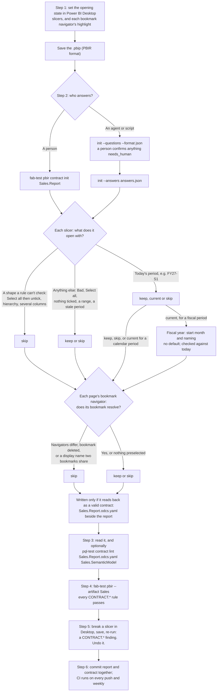

# Walkthrough: setting up a slicer contract for your report

This walks you from a Power BI report with no checks to a pipeline that fails when a slicer opens with the wrong selection, or a bookmark navigator highlights the wrong bookmark. It takes about 15 minutes. [SLICER-CONTRACTS.md](SLICER-CONTRACTS.md) is the reference; this page is the first run.

You will:

1. Save the report the way the customer agreed it should open.
2. Run `fab-test pbir contract init` to write that state down.
3. Run `fab-test pbir` to check it, then break a slicer to see it caught.
4. Commit the contract and run the check in CI, on a schedule too.



## Before you start

- **A Power BI Project in PBIR format.** In Power BI Desktop, *File → Save as → Power BI Project (.pbip)*, with the PBIR report format turned on. You should see a `<Name>.Report/definition/pages/` folder. A `.pbix`, or a `.Report` folder with only `report.json`, won't work.
- **The project in a Git repository**, so the contract can travel with the report.
- **Python 3.12 and fab-test:**

  ```bash
  pip install --pre cft-fab-test
  fab-test doctor
  ```

  `doctor` may show PBIR Inspector as ℹ *fetched on first run*. That's fine; the first `fab-test pbir` downloads it.

You don't need a Fabric workspace or credentials. Everything here reads the files on disk.

## Step 1: Set the opening state in Desktop

Open the `.pbip` and set every slicer to what the report should open with. Then **save**. fab-test reads the saved files, not what's on screen.

Be deliberate about the two states that look alike:

| On screen | What it means | In the contract |
|---|---|---|
| Nothing ticked | the slicer filters nothing | `selected: []` |
| "Select all" ticked | every value ticked; also filters nothing | `selected: all` |
| Some values ticked | filters to those values | `selected: [Bad, Good]` |

"Nothing ticked" and "Select all" show the same rows, but the report looks different when it opens, so the contract keeps them apart. A report saved with "Select all" fails a contract that expects nothing ticked, and the other way round. Pick the one the customer agreed to.

Avoid "Select all" and then unticking a few values. fab-test can't check that shape and only offers to skip it.

If a page has a **bookmark navigator**, click the bookmark it should show as selected (or none) before you save; that highlight is what gets checked.

## Step 2: Build the contract

From the repository root, point `init` at the report folder:

```bash
fab-test pbir contract init "Sales.Report"
```

`init` lists every slicer, page by page, and asks one question each. Type a choice or its first letter (`k`, `c`, `s`), or press Enter to take the default.

```text
Overview: 'Product'[Category] opens with Bikes. Keep checking that or skip it?
  [keep/skip] default keep:
Overview: 'Calendar'[Fiscal Semester] opens with FY27-S1, which looks like the current period (FY{fiscal_year_short}-S{fiscal_semester}). Keep FY27-S1 always, follow the current period, or skip it?
  [keep/current/skip] default current:
Overview: 'Region'[Region] opens with Select all. Keep checking that or skip it?
  [keep/skip] default keep:
```

How to answer:

- **keep**: check that the slicer always opens with exactly this. Use it for fixed agreements ("Alignment = Bad", "Select all", "nothing ticked").
- **current**: the slicer should always open on the current period ("this semester"), so the expected value moves with the date. The contract stores a pattern, not the value: `FY27-S1` becomes `FY{fiscal_year_short}-S{fiscal_semester}`, so from January the check expects `FY27-S2`, and a report still on `FY27-S1` fails. With **keep** it would pass forever.
- **skip**: don't check this slicer.

**current** is offered only when `init` recognises the value as today's period. A value like `Bikes` or `Bad` isn't a period, so it gets keep or skip. Neither does a period label that's out of date (`2025 H2` in November 2026): if it's meant to follow the current period, fix it in Desktop first and run `init` again.

Bookmark navigators come after the slicers, one question per page, also keep or skip:

```text
Overview: the bookmark navigator opens with Home. Keep checking that or skip it?
  [keep/skip] default keep:
```

If you answered **current** for a fiscal period (`FY27-S1`, `FY26`), two more questions follow. They have no default: nothing in the report says when your company's fiscal year starts, and on any one day several months fit.

```text
Which month does your company's fiscal year start in (1-12)? Today's values fit 6, 7, 8, 9, 10 or 11.
  [1-12]: 7
Is July 2026 to June 2027 called FY27 (the year it ends in) or FY26 (the year it starts in)?
  [end/start]: end
```

A calendar period (`2026 H2`, `2026-11`) doesn't need these, and a January fiscal year skips the second. Next time you run `init` on this report, your answers are the defaults. If a slicer isn't on today's period under the fiscal year you give, `init` stops and says so: either the answer is wrong, or the report is out of date and needs fixing in Desktop.

`init` writes `Sales.Report.odcs.yaml` **beside** the report folder, never inside it: Fabric's Git sync deletes files inside a report folder that aren't part of the report. It pairs with the report through the `logicalId` in `Sales.Report/.platform`, so renaming the report folder doesn't break the pairing.

Add `--dry-run` to see the file without writing it. `-q` prints one line when it succeeds (`contract written added=12 replaced=0 kept=0 unchanged=0 Sales.Report.odcs.yaml`), and `-v` lists every rule in the contract with what it checks and whether it was added, kept or replaced.

### Letting an agent build it instead

The questions are data, so a coding agent (or a script) can drive `init` without a terminal. Without `--answers`, `init` asks only when stdin and stderr are both a terminal (on Windows, a real console: a stdin on NUL, which is how coding agents run commands, doesn't count); otherwise it exits 2 and names these flags rather than answering for anyone:

```bash
fab-test pbir contract init "Sales.Report" --questions --format json > questions.json
# review questions.json; anything with "needs_human": true is a judgment call
fab-test pbir contract init "Sales.Report" --answers answers.json
```

`answers.json` maps question ids to answers, for example `{"overview-category": "keep", "overview-fiscal-semester": "current", "calendar.fiscal_year_start_month": 7, "calendar.fiscal_year_named_by": "end"}`. Anything left out takes the suggestion, except the fiscal year, which has none: a fiscal period answered `current` without it exits 2. The fiscal-year questions are always marked `needs_human`, so a person has to answer them.

## Step 3: Read what it wrote

Open `Sales.Report.odcs.yaml`. Each rule sits under the table and column its slicer is bound to and names the page by its display name:

```yaml
customProperties:
  - property: fabTestReport
    value: 3f1c...            # the report's logicalId; this is the pairing
  - property: fabTestCalendar
    value: {fiscal_year_start_month: 7, fiscal_year_named_by: end}
schema:
  - name: Product
    properties:
      - name: Category
        quality:
          - id: overview-category
            type: custom
            engine: fab-test
            implementation:
              page: Overview
              selected: [Bikes]
  - name: Region
    properties:
      - name: Region
        quality:
          - id: overview-region
            type: custom
            engine: fab-test
            implementation:
              page: Overview
              selected: all
```

Bookmark navigators are listed under `customProperties`, by the bookmark's display name (`null` means nothing preselected):

```yaml
  - property: fabTestBookmarkNavigators
    value:
      - id: overview-bookmark-navigator
        page: Overview
        selected: Home
```

The contract lists only the tables and columns your slicers use, not the whole model. A report with navigators but no slicers can leave `schema` out entirely.

It's a standard ODCS contract, so pql-test (installed with fab-test) can lint it. Passing the semantic model checks that every table and column it names exists:

```bash
pql-test contract lint "Sales.Report.odcs.yaml" "Sales.SemanticModel"
# Sales.Report.odcs.yaml: valid ODCS v3.1.0, ... rules, names resolve.
```

Things you can change by hand:

- `severity: warning` on a rule makes a mismatch a warning instead of an error.
- Comments (`# agreed with Finance, 2026-11`) are safe from `init`: it won't rewrite a file containing `#` unless you pass `--force`, and `--force` drops them.
- The other check shapes are listed in [SLICER-CONTRACTS.md §3](SLICER-CONTRACTS.md#3-edit-the-contract-by-hand).

## Step 4: Run the check

```bash
fab-test pbir --artifact Sales
```

```text
📋 Artifact: Sales.Report
📜 Slicer contract: Sales.Report.odcs.yaml (12 slicer checks, 3 bookmark navigators)
📊 3 finding(s) (2 error(s), 1 warning(s)): 3 from the PBIR rules, 0 from the slicer contract
```

A run checks two sets of rules: the **PBIR rules** every report gets (fab-test's packaged ones, or your `--rules` file) and the **slicer contract's** rules, whose ids start with `CONTRACT.`. The 📜 line says which contract this report paired with, and the 📊 line splits the findings between the two. Above, the contract passed, and the three findings are ordinary PBIR rule findings. In the JSON envelope every finding and test result carries `source`: `rules` or `contract`.

**Which contract?** The one whose `fabTestReport` matches the `logicalId` in the report's `.platform`, wherever it sits under `--artifact-dir`; the file name doesn't matter. If none matches, the 📜 line says `none` and names the `logicalId` it looked for. `--artifact` narrows the reports checked, not the contracts read: every contract under `--artifact-dir` is read first, so a broken one for another report still stops the run (exit 2, with a note saying so).

On a report saved straight after `init`, every `CONTRACT.*` rule passes: `0 from the slicer contract`.

Add `--open-report` to see it in a browser. The page is fab-test's, the same as `bpa`'s, with links at the top. A line names the contract's path, its checks and how many failed (with no contract, it says why none paired), and how the PBIR rules did. Below it is one filterable results table for both rule sets: the **Source** column says *PBIR rules* or *Slicer contract (its file name)*, so searching for the file name leaves only the contract's rows. A contract check is one row, its worst result across the pages it ran on, whose message is what it found, or what it expects when it passed. **PBIR Inspector's page**, collapsed at the bottom, frames its own TestRun.html (screenshots, page wireframes, its own filters), where the contract's rules are under the ruleset *Slicer contract* and the PBIR rules under *Rules*; *Open it in its own tab* gives it the whole window.

## Step 5: Prove it catches a mistake

Don't trust a check you haven't seen fail. In Desktop, change one slicer (tick an extra value, or clear the "Select all" one), save, and run the check again:

```text
CONTRACT.overview-region  error  Overview  'Region'[Region] opens with [no selection]; the contract expects Select all
```

Undo the change in Desktop and save. The check passes again.

For calendar rules, look ahead instead of waiting for the rollover:

```bash
fab-test pbir --artifact Sales --as-of 2027-01-15
```

That run shows what fails on the first day of the next semester if nobody moves the slicer. It should fail until someone updates the report, which is the point.

## Step 6: Commit and run it in CI

Commit the report and its contract together:

```bash
git add "Sales.Report" "Sales.Report.odcs.yaml"
git commit -m "Add slicer contract for Sales"
```

Then add a pipeline. Copy one of these into your repository:

- GitHub Actions: [`examples/github-actions/slicer-defaults.yml`](examples/github-actions/slicer-defaults.yml)
- Azure DevOps: [`examples/azure-devops/slicer-defaults.yml`](examples/azure-devops/slicer-defaults.yml)

Both run on every change to a report or contract, **and on a weekly schedule**. Keep the schedule: a calendar-driven default goes stale at rollover with no commit, so a push-only pipeline never notices.

`fab-test pbir` exits `1` when a contract rule fails and `2` when a contract can't be read (a typo in the YAML, an unknown calendar field), before any check runs.

## Keeping it up to date

- **Added a slicer?** Run `init` again. It asks about every slicer again but only adds rules for new ones; a rule already in the contract stays as it is unless you pass `--force`.
- **The agreed default changed?** Change it in Desktop, save, and either edit the rule's value or run `init --force`, which replaces the check and keeps anything else you added to the rule.
- **Renamed a page?** The rules on it fail, along with a `CONTRACT.page.<name>` finding, until you update `page:` in the contract. A rule never passes because its page or slicer went missing.

## When something doesn't fit

| You see | Why | What to do |
|---|---|---|
| `init` offers only `skip` | "Select all" with values unticked, a hierarchy slicer, or several columns | Save a plain selection, or leave it unchecked |
| A finding saying "a selection this check can't read" | the slicer was changed to one of the shapes above | Re-save it as a plain selection |
| Two slicers on one page bound to the same column | a rule checks every slicer on its column and page | Skip one, or give them identical selections |
| "the report has no bookmark by that name" | a bookmark was renamed or deleted | Update `selected:` to the new name, or restore the bookmark |
| "bookmarks share that name", or `init` offers only `skip` | two bookmarks have the same display name | Rename one; a name has to say which bookmark |
| Two bookmark navigators on one page, `init` offers only `skip` | they preselect different bookmarks | Make them agree, or leave the page unchecked |
| `exit 2` naming a JSON path | the contract YAML doesn't validate | Fix the key it names; nothing ran |
| `📜 Slicer contract: none (... has fabTestReport <id> ...)` | no contract's `fabTestReport` matches that `logicalId` in `.platform` | Re-run `init`, or set `fabTestReport` to that id, or pass `--contract FILE` |
| exit 2 for a contract you didn't ask about | every contract under `--artifact-dir` is read, even with `--artifact` | Fix it, or narrow `--artifact-dir` |
